# QuantFace: Efficient Quantization for Face Restoration

[Jiatong Li](https://github.com/jiatongli2024), [Libo Zhu](https://github.com/LiBoZhu030073), [HaoTong Qin](https://htqin.github.io/), [Jingkai Wang](https://github.com/jkwang28), [Linghe Kong](https://www.cs.sjtu.edu.cn/~linghe.kong/), [Guihai Chen](https://scholar.google.com.hk/citations?user=rqZWbYgAAAAJ&hl=en), [Yulun Zhang](http://yulunzhang.com/), and [Xiaokang Yang](https://scholar.google.com/citations?user=yDEavdMAAAAJ) "QuantFace: Efficient Quantization for Face Restoration", arXiv, 2025

[[arXiv](https://arxiv.org/pdf/2506.00820)] [[supplementary material](https://github.com/jiatongli2024/QuantFace/releases/download/v1/supp.pdf)] [visual results] [models]


#### 🔥🔥🔥 News

- **2025-6-1:** This repo is released.

---

> **Abstract:** Diffusion models have been achieving remarkable performance in face restoration. However, the heavy computations hamper the widespread adoption of these models. In this work, we propose QuantFace, a novel low-bit quantization framework for face restoration models, where the full-precision (i.e., 32-bit) weights and activations are quantized to 4~6-bit. We first analyze the data distribution within activations and find that it is highly variant. To preserve the original data information, we employ rotation-scaling channel balancing. Furthermore, we propose Quantization-Distillation Low-Rank Adaptation (QD-LoRA), which jointly optimizes for quantization and distillation performance. Finally, we propose an adaptive bit-width allocation strategy. We formulate such a strategy as an integer programming problem that combines quantization error and perceptual metrics to find a satisfactory resource allocation. Extensive experiments on the synthetic and real-world datasets demonstrate the effectiveness of QuantFace under 6-bit and 4-bit. QuantFace achieves significant advantages over recent leading low-bit quantization methods for face restoration.

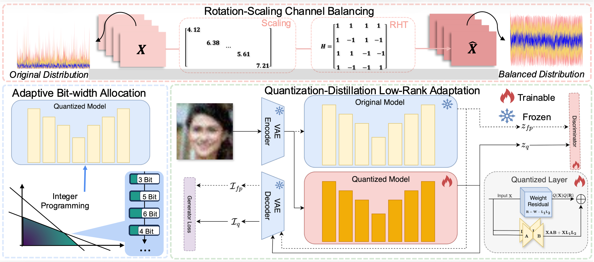
---

<!--  -->

[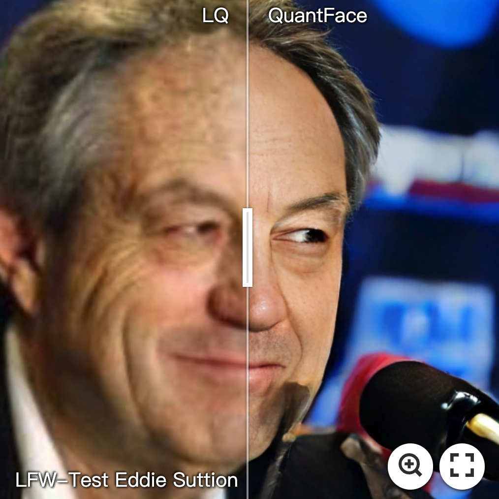](https://imgsli.com/NDMwMDcx) [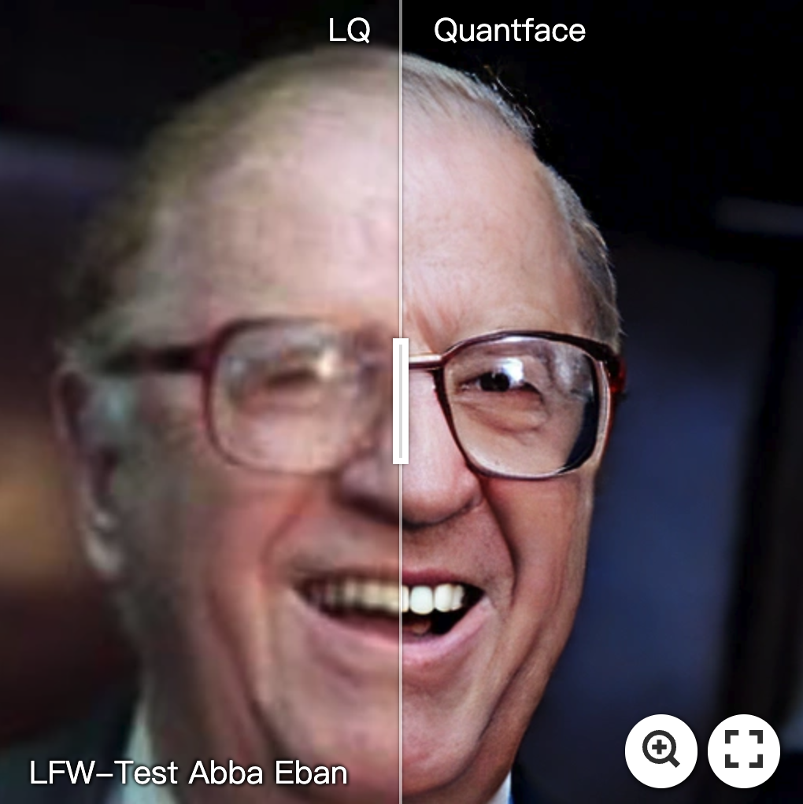](https://imgsli.com/NDMwMDY2) [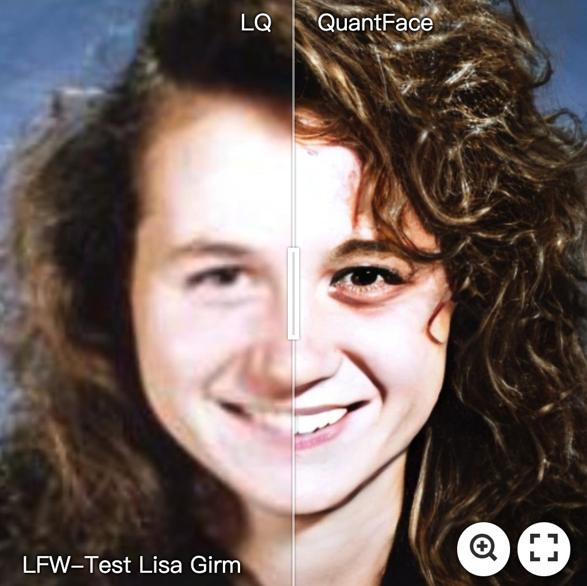](https://imgsli.com/NDMwMDY5) [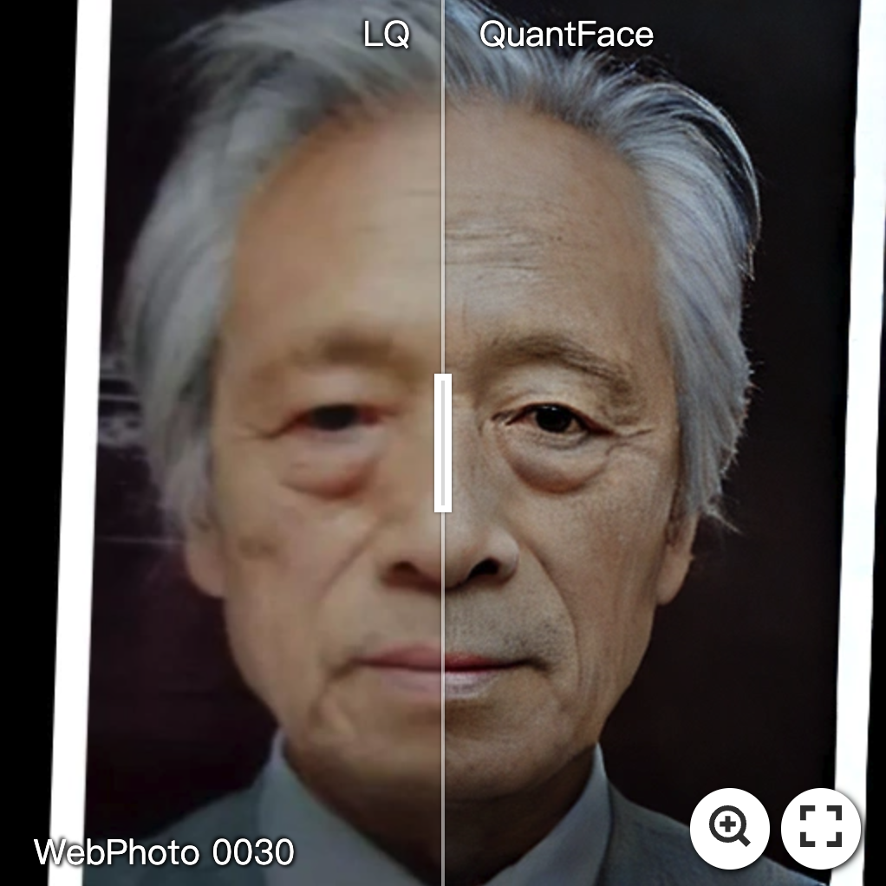](https://imgsli.com/NDMwMDcz)

[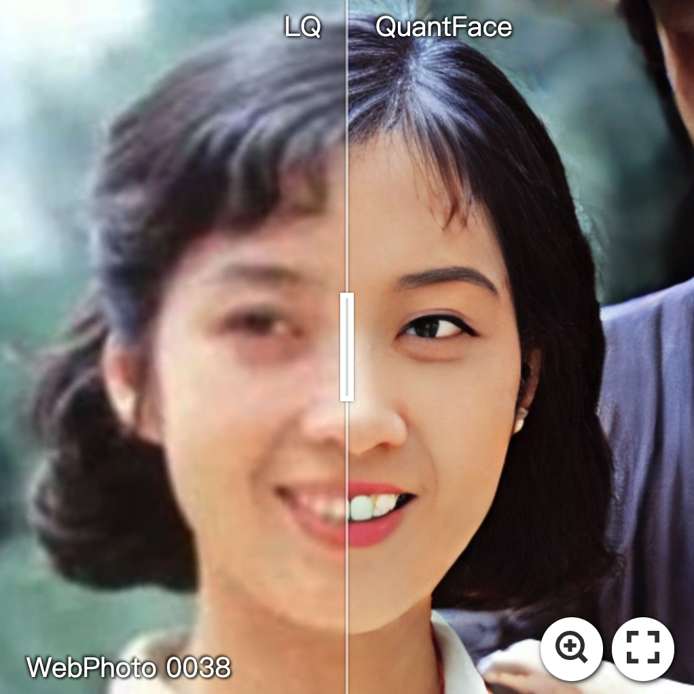](https://imgsli.com/NDMwMDc1) [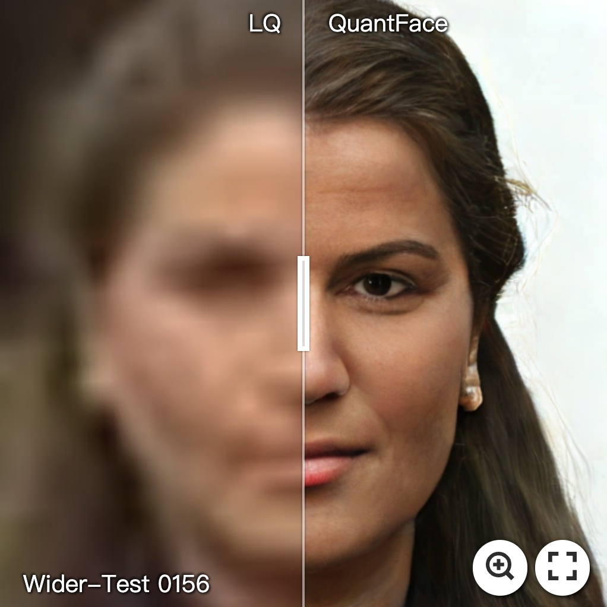](https://imgsli.com/NDMwMDc2) [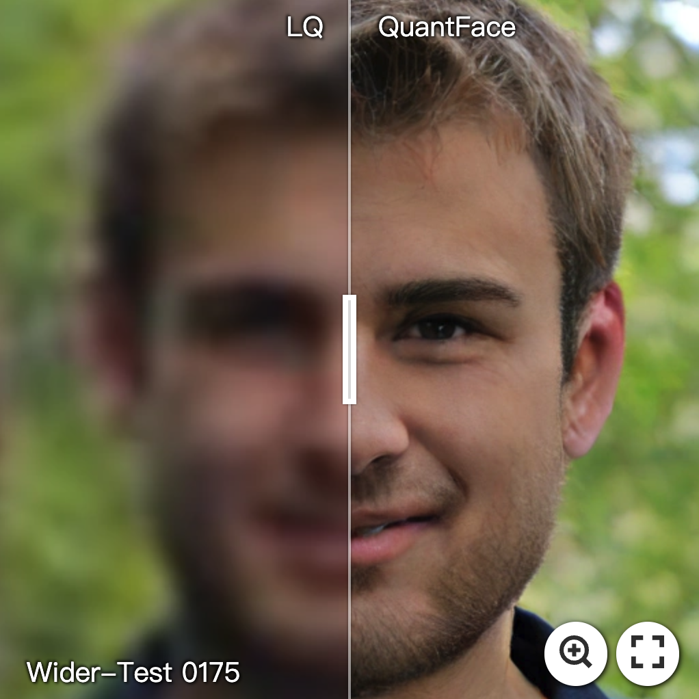](https://imgsli.com/NDMwMDc3) [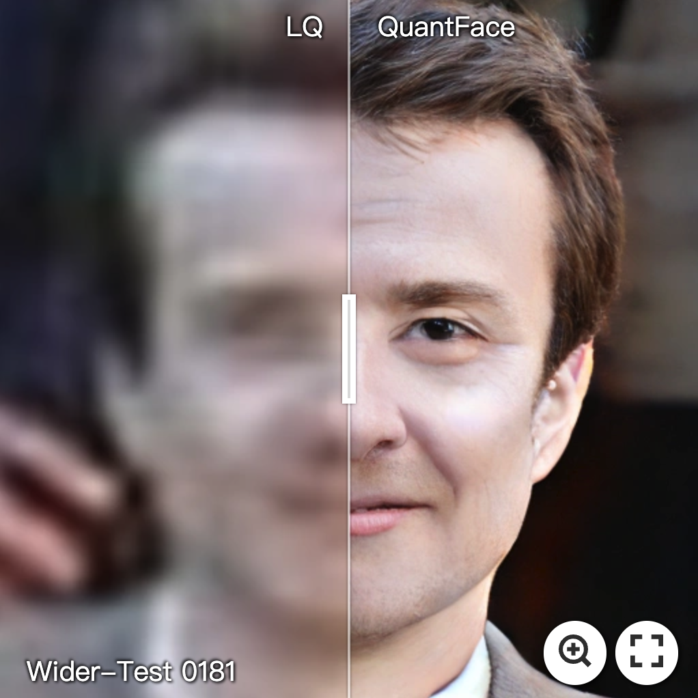](https://imgsli.com/NDMwMDc4)

---

## 🔖 TODO

- [ ] Complete this repository

## 🔗 Contents

- [ ] Quick Inference
- [ ] Train
- [x] [Results](#Results)
- [x] [Citation](#Citation)
- [x] [Acknowledgements](#Acknowledgements)


## <a name="results"></a>🔎 Results

We achieve impressive performance on the Synthetic Datasets and the Real-World Datasets.

<details open>
<summary>Quantitative Results (click to expand)</summary>

- Results in Tab. 1 of the main paper

<p align="center">
  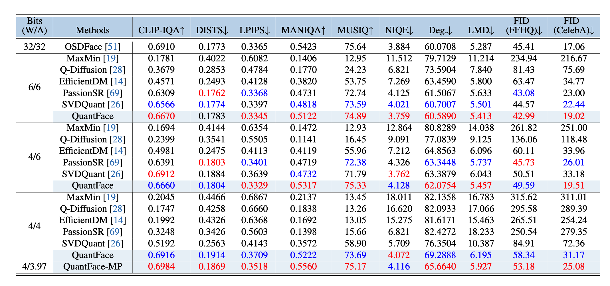
</p>


- Results in Tab. 3 of the main paper

<p align="center">
  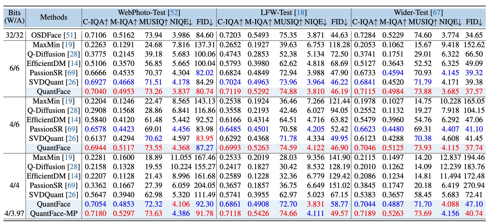
</p>
</details>

<details open>
<summary>Qualitative Results (click to expand)</summary>

- Results in Fig. 6 of the main paper

<p align="center">
  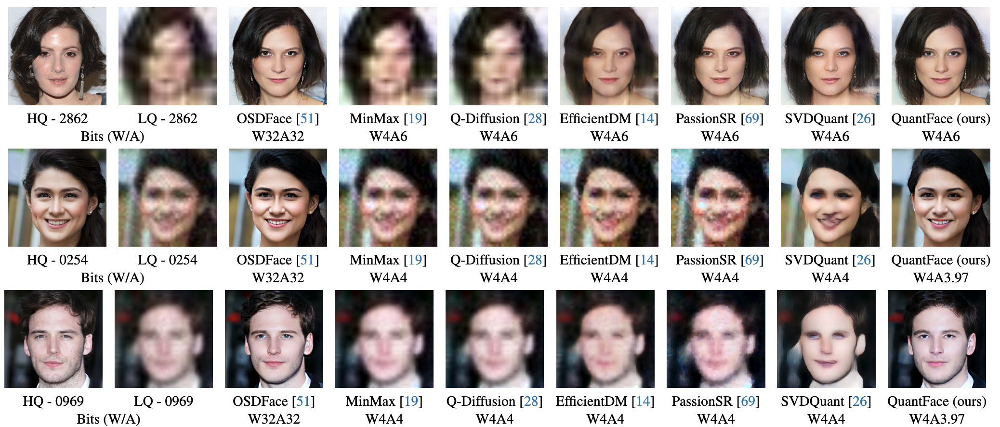
</p>

- Results in Fig. 7 of the main paper

<p align="center">
  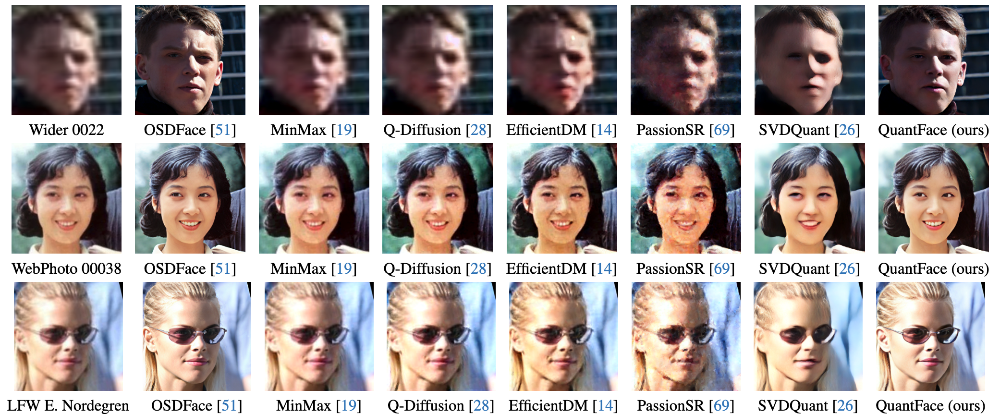
</p>
</details>

## <a name="citation"></a>📎 Citation

If you find the code helpful in your research or work, please cite the following paper(s).

```
@article{li2025quantfacelowbitposttrainingquantization,
      title={QuantFace: Low-Bit Post-Training Quantization for One-Step Diffusion Face Restoration}, 
      author={Jiatong Li and Libo Zhu and Haotong Qin and Jingkai Wang and Linghe Kong and Guihai Chen and Yulun Zhang and Xiaokang Yang},
      journal={arXiv preprint arXiv:2506.00820},
      year={2025}
}
```

## <a name="acknowledgements"></a>💡 Acknowledgements

This project is based on [Q-Diffusion](https://github.com/Xiuyu-Li/q-diffusion), [QuaRot](https://github.com/spcl/QuaRot), [SmoothQuant](https://github.com/mit-han-lab/smoothquant), [PassionSR](https://github.com/libozhu03/PassionSR), and [Q-DiT](https://github.com/Juanerx/Q-DiT).